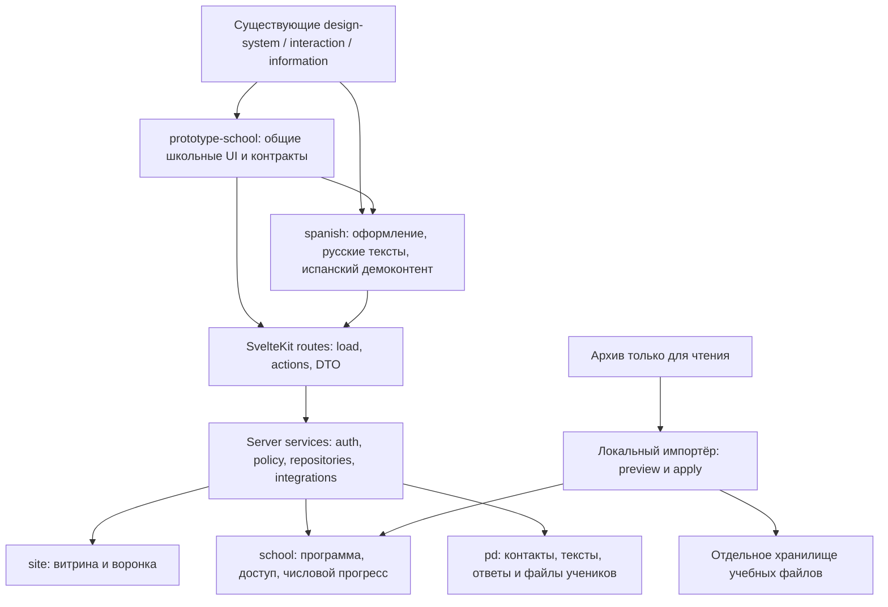

> Исторический план первой итерации. Рабочая реализация и текущие инструкции: [HANDOFF](../HANDOFF.md). Общие экраны кабинетов объединены в prototype-school/component/page/school-desk.

# Онлайн-школа: композиция первой итерации

Дата: 28.10.2026. Объём этой итерации уточнён последним сообщением владельца: разобраться в переиспользовании, размещении компонентов и полной композиции страниц. **Это проверенный план реализации, а не готовая LMS.** Прикладной код сайта в этой итерации не изменялся. Статус дальнейшей работы и точка продолжения — в конце документа.

## Открыть существующий сайт и проверить карту

Из корня `D:\2026\cloudflare`:

```powershell
yarn myspanish
```

Существующий Vite-конфиг задаёт `http://localhost:5176` и `strictPort`. Если зависимости отсутствуют, сначала `yarn install` из `myspanish.space/myspanish.space`. Команда запускает прежний сайт; новые кабинеты из этой карты ещё не созданы. Старое README предупреждает о fallback-данных без bindings; реальное сохранение заявки нужно отдельно проверять в локальном Worker-окружении, а не считать успешным по виду страницы.

```powershell
cd myspanish.space/myspanish.space
yarn check
node docs/school-composition/verify.mjs
```

[composition.mjs](composition.mjs) — полный реестр решений: 78 компонентов, 42 маршрута, 17 сборок и 17 групп критических проверок. Каждая строка существующего компонента содержит его **реальный логический адрес**. Проверка разрешает адрес через `modules.json`, сверяет manifest, `index.svelte` и recipe; для нового компонента проверяет владельца и отсутствие коллизии. Проверка карты не проверяет поведение приложения.

## Что уже есть и что действительно прочитано

- Прочитаны инструкции workspace, `.docs/project-management.md`, `myspanish.space/{AGENTS,ROLES,PROTOCOL}.md`, `stylist-svelte/AGENTS.md`, README сайта и обоих доменов.
- Изучены `svelte.config.js`, `vite.config.ts`, `package.json`, `wrangler.jsonc`, hooks, auth, endpoint заявок, первоначальная SQL-миграция, Header, layout, главная. В библиотеке прочитаны manifest, механизм module aliases, реализации/контракты ключевых кандидатов: quiz, courses, flashcards, tutor report, lesson planner, calendar, timetable, table, upload, shell, navigation, autumn landing/instructor.
- Учтены существующие ADR-0002/0003/0004 и логическая модель `.docs/myspanish.space/data-model/logical-model.md` от 21.10.2026. Это проектные документы со статусом черновика/Proposed; их существование не означает, что описанные сервисы развёрнуты.
- Проект сайта уже существует: SvelteKit 2, Svelte 5, TypeScript, Yarn 4, Cloudflare adapter, D1, KV, R2. Версии не менялись. Alias `$stylist/<domain>` уже строится из `modules.json`; переносить домены или создавать параллельный `modules/spanish` не нужно.
- Фактический испанский домен: `stylist-svelte/modules/business/spanish`. Общий: `stylist-svelte/modules/prototype/prototype-school`. Упомянутый владельцем `modules/spanish` трактуется как существующий логический домен `spanish`; новая физическая копия привела бы к дублированию.
- `scripts/spanish-folder-status/README.md`, пофайловый CSV и копия указанного учебного архива в просмотренных каталогах workspace не обнаружены. Дополнительно проверены ожидаемые пути в пуле `myspanish.space` и `D:/2026/projects/vibe-management.pro`, верхние уровни `D:/2026/Школа` и `D:/2026/Марина`. Полный диск не индексировался; часть временных папок workspace недоступна для чтения. **Содержимое учебного архива не прочитано.** В будущем импорт начинается с его README и реального реестра, а не с предположений о колонках.
- Цифры 4892/2565 от 27 октября — только сведения из запроса владельца. Они не подтверждены текущим сканированием. Аудитория, возраст, готовность направлений и права по папкам не устанавливаются.

## Архитектура и границы



**В библиотеке нет запросов к БД, секретов, SvelteKit locals или доверия к роли из props.** Общие компоненты получают безопасные DTO и callback-команды. Аутентификация, права, валидация, загрузки, импорт и сохранение выполняются на сервере приложения. В `spanish` размещаются композиции именно этой школы, тексты и собственный демонстрационный материал. `prototype-school` не импортирует `spanish`; нижние уровни не импортируют школьные UI.

Сохраняем три контура существующей модели. `site` — витрина, `school` — учебные метаданные, `pd` — персональные данные, свободные ответы/заметки и приватные файлы. Сейчас сайт фактически пишет контакты в старую `DB.leads`, а целевая модель переносит их в `pd.leads` и оставляет на сайте `lead_funnel`. Это **миграционный разрыв**, который нужно реализовать явно, а не назвать уже решённым. Сайт должен вызывать школьный command service; read-only binding не подходит для назначения доступа и проверки работ.

Для автономного локального сценария предлагается отдельный local-only набор SQLite-баз `site/school/pd` и файловый адаптер за теми же интерфейсами, а не обязательный внешний PostgreSQL на первом запуске. Адаптер локального `pd` не должен активироваться в production. Production-провайдер `pd`, размещение и перенос данных требуют отдельной реализации и сведений владельца. Наличие в старом черновике фразы об ИП не считается подтверждением юридических реквизитов.

### Нужные дополнения модели, без дублирования старых сущностей

| Требование | Существующая целевая модель | Дополнение для LMS |
|---|---|---|
| Пользователь и роли | `users`, `user_roles`, `students`, `teachers`, `teacher_student_links` | Auth identity переводится с Telegram id на непрозрачный `users.id`; право из актуальной БД, не только JWT |
| Семья | `student_guardians` | Серверная проверка действующей связи для каждого childId; родитель читает, ответ ребёнка от своего имени не подаёт |
| Курс, модуль | `courses`, `course_modules`, `enrollments` | Публикация/версии контента; enrollment и разрешение файла проверяются отдельно |
| Учебный урок | `curriculum_units` описывают юнит, `scheduled_lessons` — событие | Добавить `content_lessons` и типизированные блоки внутри юнита; не переименовывать событие в страницу урока |
| Упражнение | `exercises`, `exercise_attempts` | Версии, multiple choice и flashcards; ключи проверки отдельно от learner DTO |
| Материал/файл | `materials`, `files`, `lesson_materials` | M:N с content lesson, provenance, source path, независимые статусы, missing, checksum |
| ДЗ/ответ/проверка | `homework_assignments`, `homework_submissions`, `feedback_items` | Отдельный draft до submitted; `submission_reviews` как история проверок/возвратов; immutable попытки |
| Расписание/группы | `scheduled_lessons`, `groups`, `group_members` | Явный rescheduled/source event; время UTC, вывод в IANA timezone профиля |
| Назначение доступа | `entitlements` | Назначение группе материализует разрешения участникам с причиной; выход из группы отзывает только этот источник |
| Заявка | `pd.leads`, `site.lead_funnel` | Направление, idempotency, обработка статуса и notes через `pd`; без повторного копирования контактов |
| Завершение/избранное | Частично отражено моделью прогресса | `lesson_completions` и `material_favorites` с уникальным student/resource; повтор POST безопасен |
| Импорт | Нет готового импортёра в сайте | `import_sources`, `import_runs`, `import_records`; уникальность source+relative path; отчёт и версия mapping |

Новые SQL-миграции additive, существующие миграции/seed не переписываются. Нельзя автоматически применять старый seed с отзывами как подтверждённый школьный контент. При первом сквозном сценарии транзакционно сохранять назначения и переходы состояния; конкуренцию ограничить уникальными ключами и условными обновлениями с version. Между `pd` и `school` нет общей транзакции: сначала идемпотентная запись private payload, затем metadata-команда; незавершённые операции видны для retry/reconciliation и не показываются как отправленные.

## Выбор компонентов

| Решение | Количество | Использование |
|---|---:|---|
| Переиспользовать | 32 | Button, InputText, TextArea, Checkbox, Radio, Selector, Badge, Heading, PageShell, SectionHeading, Grid, HeroSection, StepsSection, AccordionGroup, Dialog, Tabs, NavigationDrawer, SearchBar, FilterBar, DataTable, Pagination, FileUpload, AttachmentPreview, DownloadCard, AudioPlayer, VideoPlayer, Image, Alert, Skeleton, Spinner, ThemeProvider, Icon |
| Адаптировать | 4 | Sidebar: русские aria-label; SchoolAppMenu: маршруты и готовность; EventCalendar: timezone и mobile list; LessonPlanEditor: контракт сохранения плана |
| Выделить из демо | 5 | CoursesDemo: outline; QuizPlayerDemo: single choice; FlashcardsDemo: повторение; TutorReportDemo: feedback; StudentProfileDemo: секции профиля |
| Исключить из новой композиции | 4 | AutumnLanding/AutumnInstructor: фиксированный сезонный текст и неподтверждённые сведения; AdminShell: туристический default и неадаптивное отключение sidebar; Timetable: школьная сетка периодов |
| Создать | 33 | 27 общих школьных компонентов и 6 специфичных для `spanish`; полный список ниже |

`reuse` означает подходящий кандидат с существующим контрактом, **не пройденную проверку доступности/адаптивности**. Перед подключением проверяется конкретный API и поведение. Из `extract` берём отдельные удачные элементы и алгоритмы, а не копируем целую страницу вместе с локальным состоянием. `quizScore`, `validQuizQuestion`, `annotateText` — полезные существующие функции; первая модель покрывает single choice, не универсальные семь типов. Её `correctId` нельзя выдавать как часть DTO закрытого теста.

### Новое в `prototype-school`

| Joint | Families |
|---|---|
| `component/template` | `school-workspace` |
| `component/molecule` | `course-card`, `exercise-single-choice`, `exercise-multiple-choice`, `exercise-matching`, `exercise-gap-fill`, `exercise-ordering`, `exercise-flashcards`, `exercise-free-text`, `material-card`, `linked-child-switch`, `school-empty-state` |
| `component/organism` | `course-outline`, `lesson-reader`, `exercise-player`, `homework-response`, `submission-review`, `material-catalog`, `course-access-dialog`, `course-editor`, `lesson-block-editor`, `student-record`, `school-schedule`, `school-profile-form`, `school-enquiry-form`, `school-enquiry-inbox`, `archive-import-preview` |

У каждого компонента — собственная family, `interface/recipe/<family>`, атомарные slot/behavior по необходимости, `state.svelte.ts` для логики и проверяемая story. Общие типы вынести в `type/struct/<family>` или `type/alias/<family>`, чистую проверку — в `function/check/<family>`, преобразования — в `function/transform/<family>`. Интерфейсы API — в `interface/contract`, не в компоненте. Generated barrels/manifest вручную не менять; новые адреса потребитель может импортировать прямо. Генерация — отдельное действие разрешённым механизмом, не условие для ручного исправления индекса.

### Новое в `spanish`

- `component/organism/school-header`, `school-footer`: школьный бренд и меню. Начать с существующего `src/lib/components/Header.svelte`, сделать его потребителем общего контракта, затем удалить дублирование после проверки потребителей.
- `component/page/school-home`, `school-directions`, `school-direction`, `spanish-demo-lesson`: композиции этой школы поверх общего школьного UI.
- `const/object/school-config`: единственный источник временного имени «Школа испанского», `teacher: null`, `contacts: {}`, `legal: { status: 'draft' }`, `prices: null`, `schedule: null`, `testimonials: []`. Данные не должны появляться из произвольных fallbacks в Header/SEO/footer.
- `type/struct/school-config` и `interface/contract/school-settings`: типы и редактируемый безопасный контракт; серверные integration secrets хранятся отдельно.
- `data/json/spanish-beginner-demo`: собственный демокурс, 3 урока, без внешних учебников. `function/create/school-menu` и его тексты адаптировать к карте ниже; объявлять ready только существующие проверенные страницы. Оплата до подключения провайдера не предлагается как работающее действие.

Информационные публичные страницы можно собирать в SvelteKit из `Heading`, текстовых блоков, FAQ и lead form; отдельный компонент на каждую короткую страницу не нужен. Учебные кабинеты используют общие компоненты напрямую; не создавать испанские копии каждой таблицы/формы.

## Страницы и композиция

### Оболочки

`(public)/+layout.svelte`: ThemeProvider из корневого layout → PageShell → SchoolHeader → контент → SchoolFooter. Одна верхняя CTA «Записаться на знакомство». Mobile: logo/menu/account, в drawer реальные ссылки, Escape и возврат фокуса. На desktop — основные ссылки, остальное доступно через меню.

`(school)/+layout.server.ts`: обязательная сессия → свежие роли → область доступа. `SchoolWorkspace`: desktop Sidebar и mobile NavigationDrawer, заголовок текущей страницы, timezone/профиль, main, общие loading/error states. Parent child selector задаёт контекст просмотра, но не выдаёт разрешение. Staff и learner DTO различаются. В каждый protected action/API/file endpoint проверка повторяется.

Route groups не добавляют сегментов в URL. Существующий `/admin` остаётся админкой квиза; `/staff` — новый школьный кабинет. Перехват `startsWith('/admin')` в старом hook не считать достаточной защитой новых URL/API.

### Публичная часть

| URL | Композиция |
|---|---|
| `/` | Hero: чему учим + как устроено → две CTA → направления → этапы обучения → пример демоурока → преподаватель только при подтверждении → FAQ → заявка |
| `/directions` | Заголовок → фильтры level/audience/topic/format → course cards со статусом → pagination/empty |
| `/directions/[slug]` | Для кого → входные знания → цели и содержание → outline → пример задания → формат и инвентарь → заданные цена/расписание → заявка с выбранным направлением → related |
| `/how-it-works` | Короткие этапы → что происходит на уроке/между уроками → знакомство/заявка |
| `/teacher` | Только подтверждённые сведения; до них честное «Информация о преподавателе уточняется», заявка |
| `/free-materials` | Поиск/публичные фильтры → только разрешённые и проверенные материалы → pagination |
| `/free-materials/[id]` | Описание, инструкция, формат → публично разрешённое вложение или «Файл пока недоступен» |
| `/faq` | Accordion → заявка |
| `/contacts` | Реальные контакты по наличию, timezone по наличию, форма; без придуманного адреса/телефона |
| `/demo/[lessonSlug]` | Метка «Демонстрационный урок» → цель → короткая инструкция → lesson reader → упражнения → следующий пример |
| `/legal/privacy`, `/legal/terms` | Явно помеченные черновики; состав документов после определения модели работы |
| `/auth/login` | Вход, ошибки, локальные тестовые роли только в development; Telegram не должен блокировать локальный сценарий |

Направления «А1», фонетика, песни, «Испанский с мамой», тематические комплекты и марафоны можно подготовить как draft-данные. Нельзя автоматически делать их доступными/идущими в набор. Публичные «доступно», «набор», «готовится» — отдельное решение редактора о программе; внутренние статусы OCR/прав на странице направления не показываются. Старые `/landing`, `/kids`, `/groups`, `/travel`, `/quiz` сохраняются до отдельной проверки их текстов и решения о redirect; не объявляются достоверными из-за наличия исходника.

### Ученик и родитель

| URL | Композиция |
|---|---|
| `/account` | Связанный ребёнок для parent → продолжить курс → ближайшее занятие → открытые задания → опубликованный feedback |
| `/account/courses` | Только назначенные course cards, прогресс и доступность |
| `/account/courses/[id]` | Outline модулей/уроков, даты/доступ/прогресс |
| `/account/lessons/[id]` | Outline desktop → цель и инструкция → блоки → упражнения → ДЗ → завершить → следующий урок |
| `/account/homework` | Фильтры статуса/курса → задания и сроки → pagination |
| `/account/homework/[id]` | Инструкция → текст/загрузка → сохранить черновик/отправить → история попыток → feedback |
| `/account/schedule` | Calendar desktop / список mobile → дата, время, IANA timezone → заданная ссылка → перенос/отмена |
| `/account/materials` | Доступная библиотека → search/filters/favorites → pagination |
| `/account/profile` | Имя, timezone, уведомления; интерфейс RU на первом этапе |
| `/account/children` | Только связанные дети → просмотр выбранного контекста; без возможности добавить чужого ребёнка по id |

Parent читает курсы/уроки/работы связанных детей. Для отправки ответа в этой минимальной семейной модели ребёнок входит своей student-учётной записью; UI parent скрывает submit/complete/exercise attempts, сервер запрещает их независимо от UI. Профиль parent относится к родителю, не меняет профиль ребёнка по переданному id. Разрешение родителю действовать за ребёнка — отдельная будущая capability с автором действия в журнале.

### Преподаватель и администратор

| URL | Композиция |
|---|---|
| `/staff` | Ближайшие занятия → очередь проверки → доступные новые заявки → последние действия |
| `/staff/students` | Search/filters → таблица своих учеников → pagination |
| `/staff/students/[id]` | Карточка → назначения/история/ДЗ → private notes → access dialog |
| `/staff/groups`, `/staff/groups/[id]` | Таблица групп → состав, назначения, расписание; только управляемые преподавателем группы |
| `/staff/courses` | Курсы → создать → draft/published и preview |
| `/staff/courses/new`, `/staff/courses/[id]/edit` | Метаданные → модули → порядок уроков → публикация → назначение |
| `/staff/lessons/[id]/edit` | Редактор блоков → library picker → exercise config → ДЗ → отдельные teacher notes |
| `/staff/lessons/[id]/preview` | Learner projection без notes/ключей → заметная метка предпросмотра; без изменения прогресса |
| `/staff/review`, `/staff/review/[id]` | Фильтры student/group/course/status → очередь → ответ/вложения → feedback → вернуть/проверено |
| `/staff/library`, `/staff/library/[id]` | Каталог → provenance, независимые статусы, связи и файл → безопасное массовое редактирование |
| `/staff/library/import` | Admin: выбор зарегистрированного источника → mapping CSV → preview → dry-run report → apply → итог |
| `/staff/leads` | Заявки → контакты через private service → статус/notes → создать доступ; teacher только назначенные заявки |
| `/staff/schedule` | Расписание своих занятий, создание/перенос/отмена |
| `/staff/settings` | Admin: сведения школы, контакты, публичные тексты, направления, состояние интеграций |
| `/admin` | Существующая admin-only квиз-панель, остаётся отдельной |

Учитель не получает всех учеников/заявки школы только из-за роли teacher. Admin наделяется полной областью явно. Редактирование курсов ограничено ownership/role scope. Операции bulk в библиотеке whitelist: тема, навыки, редакционная пометка; права публикации, персональные поля и фактическая публикация требуют отдельных команд, не массового изменения флажка.

## Визуальная система и состояния

Базовое направление: тёплая бумага `#FAF8F3`, поверхность `#FFFFFF`, основной текст `#252D2A`, вторичный `#55625C`, зелёный action `#285A48`, спокойный терракотовый акцент `#AD5038`. Цвета — предложение; контраст нужно инструментально измерить до приёмки. Не переносить насыщенный осенний плакат в кабинеты. Палитру задавать существующими theme tokens, без отдельных Button/Input-клонов.

Шрифт: системный sans-serif, `Segoe UI` в Windows, без обязательной загрузки внешнего font service; проверить кириллицу и `ñ ü ¿ ¡`. Базовый размер 16px, line-height 1.55; h1 `clamp(2rem, 4vw, 3.5rem)`, h2 1.75–2.5rem, подписи не меньше 14px. Контент урока до 72ch. Контейнер публичного сайта до 1200px; кабинеты используют доступную ширину, reading column ограничена отдельно.

На 360/390px одна колонка, действия формы видны без hover, touch-target от 44px, таблицы преобразуются в карточки или имеют явно ограниченный горизонтальный scroll внутри, не на всём документе. От 768px две колонки каталога; от 1200px sidebar. Точные breakpoint зависят от фактической проверки компонентов, не только CSS.

Обязательные состояния: загрузка Skeleton; submit pending со spinner/disabled; success только после commit; ошибка рядом с полем и summary `role=alert`; пустые список/поиск/назначения; offline/503 с сохранённым вводом; 403/404 без раскрытия чужих метаданных; отсутствие вложения с доступными метаданными. Цвет не единственный носитель статуса. В Dialog обязательны Escape, trap, label и возврат фокуса. В drawer keyboard-переходы проверяются отдельно. Учебные испанские фразы размечаются `lang=es`.

## Сквозная реализация и семь упражнений

Первая рабочая вертикаль: `/directions/demo-a1` → `school-enquiry-form` → реальная заявка → `/staff/leads` → пользователь/назначение → `/account/courses` → lesson → попытка → ДЗ → `/staff/review` → feedback ученику. До подключения почты администратор передаёт доступ вручную; интерфейс пишет «Заявка сохранена», а не «Письмо отправлено».

Демокурс «Первые шаги: знакомимся» помечен как собственный демонстрационный материал, без обещаний результата:

1. **¡Hola!** Цель: узнавать приветствия. Single choice «Как поздороваться?»; multiple choice «Выберите приветствия: Hola / Buenos días / Gracias / Adiós»; карточки hola/привет, gracias/спасибо.
2. **Me llamo…** Цель: составить простую фразу знакомства. Matching hola↔привет, adiós↔до свидания; gaps «Me ___ Ana»; ordering `Me / llamo / Ana`. Сопоставление через select, порядок кнопками «Выше/Ниже»; drag необязателен.
3. **Un pequeño diálogo.** Цель: собрать и написать короткое знакомство. Повторение закрытых упражнений и свободный ответ: «Поздоровайтесь и представьтесь по-испански». ДЗ: короткий диалог, текст и необязательное разрешённое вложение. Открытые ответы проверяет учитель.

Текст/изображение/аудио/видео/attachment — блоки урока. На первом собственном демо не обязательны ненастоящие медиа: если собственного файла нет, не показывать фиктивный player. Для закрытых упражнений сервер хранит правильные ответы, schema и version, принимает идентификаторы ответов, вычисляет результат и сохраняет попытку. Возвращает понятный feedback и разрешает retry. Для flashcards хранится самооценка, не автоматически начисленный экзаменационный балл. Нормализация accents задаётся заданием; `ñ` не превращается в `n` без основания.

## Библиотека и импорт

Импортёр — локальный server/CLI инструмент приложения, UI только запускает разрешённые команды. Корень архива задаёт оператор через `ARCHIVE_SOURCE_ROOT`, браузер не может передавать произвольный абсолютный путь. Источник открывается для чтения; производные и staging хранятся отдельно. Не помещать архив в `static/` и не публиковать R2 bucket целиком.

Порядок: прочитать реальный README/отчёты/реестр → предложить mapping полей → preview без записи → показать missing/errors/skips/дубликаты → подтвердить конкретный manifest digest → apply порциями с checkpoint. CSV: UTF-8/BOM, определяемый delimiter, quoted multiline, сохраняемый original value; неоднозначные колонки требуют mapping, а не угадывания. Нельзя импортировать текст отчёта как проверенное описание без происхождения.

Identity материала: source id + нормализованный относительный путь, исходное написание пути сохраняется отдельно. Не lower-case все пути без учёта файловой системы. Физический файл, если доступен: stream SHA-256 и размер; realpath обязан оставаться внутри разрешённого root, проверяются symlink/junction. Имя не служит идентификатором содержимого. Одинаковый hash может дать общий blob, но отдельные записи источника/описания и связи не теряются. Отсутствующий файл не делает запись ошибочной для каталога метаданных. Повторный импорт делает upsert, не стирает редакторские поля и хранит provenance/изменения. Preview/apply с изменённым источником должен требовать новый preview.

Материал хранит title, description, sourceRelativePath, file format/type, bytes/hash по наличию, topic, level, подтверждённые audience/age, skills, usage instructions, related IDs, descriptionSource. Независимые поля:

- `processing`: unprocessed / partial / full, nullable при неизвестной полноте; отдельно `legacy_processed` и исходный текст признака. При единственном «обработано» полнота остаётся неизвестной.
- `editorial`: unchecked / checked / needs_fix.
- `publication`: draft / published / archived.
- `rights`: unknown / internal / public_allowed; отдельно grant evidence и scope. Internal не означает разрешение выдавать материал каждому ученику.

Публичный запрос обязан одновременно требовать `published`, `checked`, `public_allowed`, отсутствие privacy restriction. Missing file можно показывать без download. «13 Работы учеников и проверка», персональные и внутренние/технические файлы не импортируются в открытую библиотеку. Twinkl, Reading A–Z, учебники закрыты до подтверждения прав. ZIP не распаковываются по умолчанию; если позже нужен просмотр — запрет absolute/traversal, symlink, лимиты количества/размера/коэффициента сжатия до извлечения.

Каталог: серверные фильтры, ограничение длины query и page size, индексы по source/path/status/rights и связям, pagination по 25 (максимум 100), lazy thumbnails. Физический исходный путь видит staff, не public/student DTO. Файл отдаётся через `/api/files/[id]` с проверкой актуальной сессии, назначения и scope конкретного файла; homework attachments проверяются по submission student/teacher/guardian. `Content-Disposition`, `nosniff`, private/no-store; никакой выдачи «зная UUID».

## Проверки и интеграции следующей итерации

Полные сценарии перечислены в `criticalTests` реестра. Это **план тестов, не результаты запуска**. Нужны:

- Unit: schema и оценки 7 типов, границы статусов, policy, CSV mapping/path containment/hash identity.
- Integration на изолированных БД и временных файлах: lead→access, persistence, две независимые student-сессии, guardian links, область teacher, direct file URLs, отзыв доступа, цикл ДЗ/попытки/версионные конфликты, idempotency импорта и отсутствие публичных утечек.
- Playwright: браузерный сквозной сценарий с реальным локальным сервером и БД; 360/390/768/1440px; drawer/focus/keyboard; matching/ordering без мыши, формы и errors. Ручная проверка реального интерфейса отдельно от автотестов.
- `yarn check`, production build и smoke после реализации. Не считать проверку map/типов доказательством работы прав доступа.

Загрузка файлов: временный quarantine, лимит запроса и количества/размера файлов, проверка сигнатуры и MIME, allowlist PDF/JPEG/PNG/WebP/MP3/WAV/MP4 в зависимости от задачи, случайный storage key, имя только как метаданные, запрет HTML/SVG/исполняемых; при отсутствии malware scanning честный статус, небезопасные вложения не встраиваются. Привязка upload к владельцу и конкретной отправке, запрет прикрепления чужого upload id.

Заявки: строгий `consent === true` вместо старого `Boolean(value)`, валидный хотя бы один контакт, ограничения длины/type, honeypot, серверный rate limit, idempotency key. В старом handler сохранение lead и analytics идёт последовательно: сбой analytics после успешной записи может вернуть ошибку и вызвать дубль при retry. Разделить критическую запись и необязательную аналитику, обеспечить idempotency. Логи без контактов, ответов, секретов и целого request body.

Почта: локальный outbox без утверждения о доставке; встречи: вручную заданный URL с валидацией scheme; оплата: отсутствует до основного сценария, только заявка/назначение; storage: local private adapter с будущим R2/S3. Admin видит configured/local/not configured и последнюю ошибку. Env пример в следующей реализации: `APP_ENV`, `DEMO_MODE`, `AUTH_SECRET`, local database/storage paths, `ARCHIVE_SOURCE_ROOT`, public school settings; секреты почты/платежей только на сервере. Demo accounts — admin, teacher, student A/B, parent A/child A и parent B/child B — создаются только development seed, не попадают в production migration. Одного `DEMO_MODE=true` для включения тестового входа в production недостаточно.

## Состояние и продолжение

**Реализовано в этой итерации:** проверяемый реестр компонентов/маршрутов/сборок, архитектурные границы, модель дополнений, дизайн-направление, план безопасного импорта, тестовая матрица и последовательность ниже. Не создано новых учебных UI, SQL-миграций, seed или импортёра; не настроены новые роли. Не требуются ключи или сведения владельца для продолжения локальной разработки с демоданными.

**Фактически выполнено:** `yarn check` существующего сайта — 0 errors, 0 warnings; `node docs/school-composition/verify.mjs` — passed, 78 компонентов / 42 страницы / 17 сборок / 17 групп будущих тестов. Эта проверка не компилирует новые компоненты, поскольку они пока только запланированы. Build, браузерная/ручная UI-проверка, тесты импорта и учебного цикла не запускались. Браузерная среда в этой итерации не диагностировалась; нельзя утверждать, что она недоступна. Никакой публикации/удалённых миграций не выполнялось.

**Следующий конкретный шаг:** зарегистрировать новую работу с тем же task id `cc27147a-aacf-4973-ac3d-b1e46fec45d4` и фактическими путями приложения, `prototype-school` и `spanish`; ещё раз проверить актуальную координацию и изменения других участников. Текущий work ограничен этой папкой документации. Затем:

1. Локальные storage/repository adapters трёх контуров, additive schema/migrations и development seed, `school-config`, четыре роли, policy и безопасные learner/staff DTO. Сначала integration-тесты запрета чужого доступа.
2. Реальная вертикаль lead → назначение → урок → сохранение attempt → submission → review → feedback, поверх `school-workspace`, `course-outline`, `lesson-reader`, `homework-response`, `submission-review`. Данные переживают перезапуск.
3. Публичные home/directions/detail, FAQ/contacts/legal и собственный 3-урочный demo; не переносить недоказанные сведения из старых лендингов.
4. Остальные кабинеты, family read-only scope, course/lesson editors, группы, расписание и настройки, безопасные uploads/files.
5. Библиотека, реальный archive preview/apply + fixtures тесты idempotency, provenance и прав. При подключении архива первым прочитать его README и актуальный CSV.
6. Семь полноценных упражнений, mobile/keyboard и ручная проверка, production build, исправление найденных ошибок, актуальные инструкции запуска/курса/импорта и env example. Публикация остаётся отдельной задачей владельца.

**Нужны реальные сведения перед публичным запуском:** название и брендинг, подтверждённые данные преподавателя, аудитория/возраст/форматы по контенту, готовность каждой программы, цены и расписание, контакты/timezone, реквизиты и юридические тексты, права на материалы/фото/отзывы, расположение архива и его реестра, провайдер production `pd`, ключи интеграций. Отсутствующие данные временно пустые и явно обозначены, а не придумываются.

Официальные источники для выбранного подхода: [SvelteKit Cloudflare adapter](https://svelte.dev/docs/kit/adapter-cloudflare), [Cloudflare D1 local development](https://developers.cloudflare.com/d1/best-practices/local-development/). Локальные bindings/сохранение проверяются фактическим запуском следующей итерации; документ не гарантирует работоспособность текущих fallbacks.
